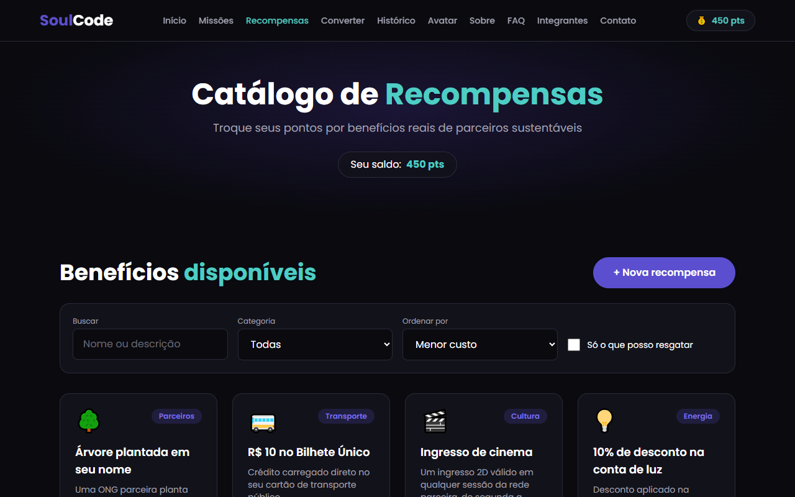
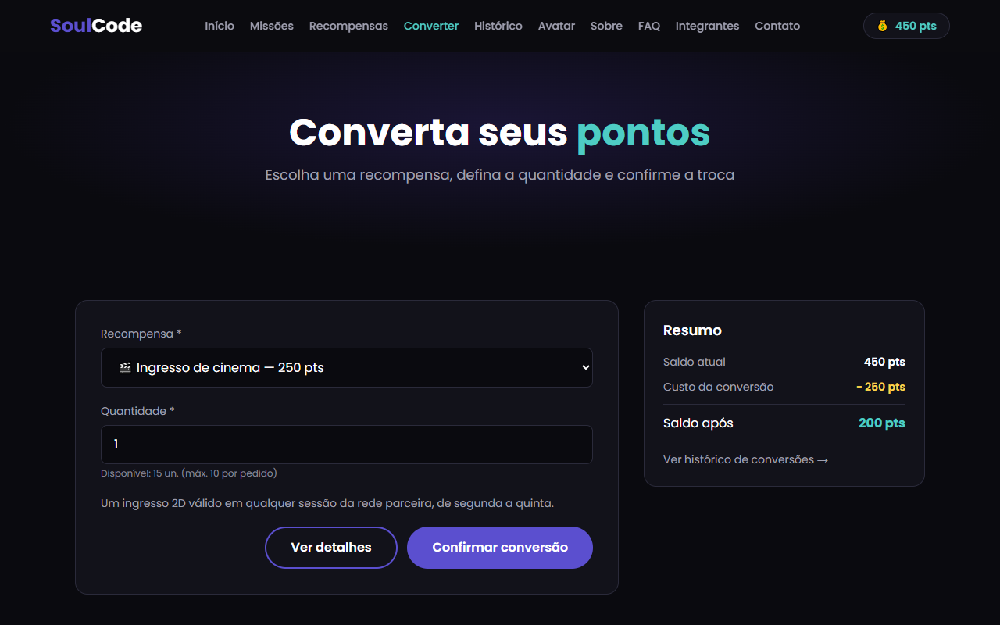

# SoulCode — Conversão de Pontos em Recompensas (Sprint 4)

Projeto da disciplina **Front-End Design Engineering** (FIAP) — Sprint 4.

A **SoulUp** é uma plataforma que conecta pessoas a ações sustentáveis do dia a dia. Com o **Avatar Inteligente**, o
usuário completa **missões**, acumula **pontos** e os **converte em recompensas reais** (descontos na conta de luz,
créditos de transporte, ingressos e mais). Esta SPA em **React + Vite + TypeScript + Tailwind CSS** consome uma
**API RESTful em Java (Quarkus)** e já funciona com dados mockados enquanto a API não é publicada.

**🔗 Acesse o site: [https://soul-code-react.vercel.app](https://soul-code-react.vercel.app)**


## Funcionalidades

- **Missões** — listagem com filtro, detalhe (`/missoes/:id`), concluir missão (soma pontos), criar, editar e excluir.
- **Recompensas** — catálogo com busca, filtro por categoria e ordenação; detalhe (`/recompensas/:id`); criar, editar,
  ativar/desativar (PATCH) e excluir com confirmação.
- **Converter pontos** — escolhe a recompensa e a quantidade, mostra o resumo do saldo e valida saldo e estoque.
- **Histórico** — conversões do usuário com filtro por status e cancelamento (estorno dos pontos).
- **Saldo sempre visível** no header via `useContext`, toasts de feedback, 404 personalizada e menu hambúrguer.

## Tecnologias utilizadas

| Tecnologia | Uso |
|---|---|
| React 19 + Vite | SPA e build |
| TypeScript (strict) | tipos, interfaces, union e intersection types |
| Tailwind CSS 3 | toda a estilização (sem CSS manual e sem bibliotecas de UI) |
| React Router DOM 7 | rotas estáticas, dinâmicas (`useParams`) e redirecionamentos |
| React Hook Form | validação dos formulários no front |
| `fetch` nativo | requisições HTTP (sem Axios) |
| Oxlint | lint (`npm run lint`) |
| Vercel | deploy |
| Java + Quarkus *(outra integrante)* | API RESTful |

## Estrutura de pastas

```
src/
  assets/      # fotos da equipe e favicon
  components/  # componentes reutilizáveis (Header, Toaster, ConfirmDialog, DataState, cards...)
  config/      # env.ts (variáveis de ambiente) e endpoints.ts (TODAS as rotas da API)
  context/     # NotificationContext (toasts) e SaldoContext (saldo de pontos)
  data/        # conteúdo estático (equipe e FAQ)
  hooks/       # useFetch<T>, useSaldo, useNotification, useIdParam, useRedirectInvalido
  mappers/     # conversão JSON da API <-> tipos do front
  mocks/       # "API falsa" em memória com CRUD, atraso e erro simulado
  pages/       # uma página por rota
  routes/      # paths.ts (rotas tipadas), navigation.ts (menu) e AppRoutes.tsx
  services/    # api.ts (wrapper do fetch) + um service por recurso
  types/       # tipos de domínio, contratos da API e tipos de UI
  utils/       # formatadores, rótulos e classes de formulário
docs/
  CONTRATO_API.md     # o que o front espera da API Java
  INTEGRACAO_JAVA.md  # passo a passo para ligar a API real
  ...
```

### Como a integração foi organizada

```
Página -> service (missaoService, recompensaService...) -> VITE_USE_MOCK?
                                                   ├─ true  -> src/mocks (em memória)
                                                   └─ false -> services/api.ts (fetch) -> API Java
          <- mapper (JSON da API -> tipo do front) <-
```

Os componentes nunca sabem se os dados vêm do mock ou da API. Para trocar, basta mudar o `.env`.

## Rotas

| Rota | Página |
|---|---|
| `/` | Home |
| `/missoes` · `/missoes/nova` · `/missoes/:id` · `/missoes/:id/editar` | CRUD de missões |
| `/recompensas` · `/recompensas/nova` · `/recompensas/:id` · `/recompensas/:id/editar` | CRUD de recompensas |
| `/converter` | Conversão de pontos (aceita `?recompensa=ID`) |
| `/historico` | Histórico de conversões |
| `/avatar` | Avatar Inteligente (chat) |
| `/sobre` · `/faq` · `/integrantes` · `/contato` | Institucionais |
| `*` | 404 personalizada |

Id inválido (ex.: `/recompensas/abc`) ou inexistente (`/recompensas/999`) redireciona para a listagem com um toast
explicando o motivo.

## Autores e créditos

| Foto | Nome | RM | Turma | Função | Links |
|---|---|---|---|---|---|
|  | Yasmin de Oliveira Matsuok | RM573083 | 1TDSPI | Front-End Design Engineering | [GitHub](https://github.com/yasminmatsuok) · [LinkedIn](https://www.linkedin.com/in/yasmin-matsuok/) |
|  | Murilo Gomes Santiago Carnaval | RM573067 | 1TDSPW | Database Administrator | [GitHub](https://github.com/murilossanttiago) · [LinkedIn](https://www.linkedin.com/in/murilo-gomes-santiago) |
|  | Davi Trindade Ribeiro | RM571336 | 1TDSPW | Backend Developer — Java & Python | [GitHub](https://github.com/davitrindadee) · [LinkedIn](https://www.linkedin.com/in/davi-trindade-b64a48378/) |
|  | Yasmin Cappi Santos | RM571926 | 1TDSPW | Documentation, UX Writing & Pitch | [GitHub](https://github.com/yasmincappi) · [LinkedIn](https://www.linkedin.com/in/yasmincappi/) |
|  | Maria Vitória Cândida Carvalho | RM570850 | 1TDSPI | Artificial Intelligence & Chatbot | [GitHub](https://github.com/mariav1110) · [LinkedIn](https://www.linkedin.com/in/maria-vitoriac/) |

## Imagens e ícones do projeto

| Catálogo de recompensas | Conversão de pontos | Histórico (mobile) |
|---|---|---|
|  |  |  |

- **Favicon / avatar Soul:** `public/favicon.png`
- **Fotos da equipe:** `src/assets/`
- **Ícones:** emojis nativos (sem biblioteca de ícones), sempre com `aria-hidden` quando decorativos
- **Fonte:** [Poppins](https://fonts.google.com/specimen/Poppins) (Google Fonts)

## Como usar

### Pré-requisitos

- Node.js 20+ e npm

### Instalação

```bash
git clone https://github.com/yasminmatsuok/SoulCode---react.git
cd SoulCode---react
npm install
cp .env.example .env     # no Windows: copy .env.example .env
npm run dev              # http://localhost:5173
```

### Variáveis de ambiente (`.env`)

| Variável | Exemplo | Descrição |
|---|---|---|
| `VITE_API_URL` | `https://api-soulcode.exemplo.com` | URL base da API Java (sem barra no final) |
| `VITE_USE_MOCK` | `true` | `true` usa os mocks; `false` chama a API real |
| `VITE_USUARIO_ID` | `1` | usuário usado enquanto não há login |
| `VITE_MOCK_ERROR_RATE` | `0` | só no mock: chance de erro 500 simulado (ex.: `0.3`) para testar as telas de erro |

> Com o mock, os dados voltam ao estado inicial ao recarregar a página (F5).

### Scripts

| Comando | Descrição |
|---|---|
| `npm run dev` | servidor de desenvolvimento |
| `npm run build` | checagem de tipos + build de produção |
| `npm run lint` | lint com Oxlint |
| `npm run preview` | serve o build localmente |

### Deploy na Vercel

1. Importe o repositório na Vercel (Framework: **Vite**, build `npm run build`, output `dist`).
2. Em **Settings → Environment Variables**, crie `VITE_API_URL`, `VITE_USE_MOCK` e `VITE_USUARIO_ID`.
3. Faça **Redeploy** sempre que mudar as variáveis.
4. O `vercel.json` reescreve todas as rotas para `index.html`, então recarregar `/recompensas/1` não dá 404.

Passo a passo completo da integração: [`docs/INTEGRACAO_JAVA.md`](docs/INTEGRACAO_JAVA.md).

### Links

| | |
|---|---|
| Repositório GitHub | https://github.com/yasminmatsuok/SoulCode---react |
| Deploy (Vercel) | https://soul-code-react.vercel.app |
| Vídeo no YouTube | [INSERIR LINK] |
| API Java (Quarkus) | [INSERIR LINK] |
| Contrato da API | [`docs/CONTRATO_API.md`](docs/CONTRATO_API.md) |

## Contato

- E-mail: contato.soulcode@fiap.com.br
- Local: FIAP — Paulista, São Paulo
- Ou pelos LinkedIns da equipe na seção [Autores e créditos](#autores-e-créditos).
